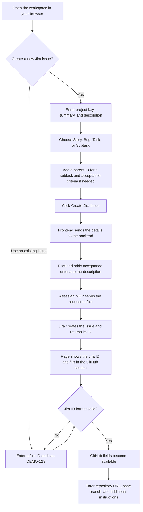

# MCP Jira + GitHub Integration

A web application for creating Jira issues and entering GitHub development details in one place. It uses an HTML and TypeScript frontend, a Python FastAPI backend, and Atlassian MCP to create Jira issues.

## Application flow



## Before you start

Install:

- Python 3.11 or newer
- Node.js with npm

You'll also need an Atlassian email address, API token, and cloud ID. Your Atlassian account must have access to the Jira project you want to use.

The commands below are for PowerShell. Run the backend and frontend in separate terminals.

## Run the backend locally

Open a terminal in the project folder and create a Python environment:

```powershell
cd backend
py -m venv .venv
```

Install the backend packages:

```powershell
.\.venv\Scripts\python.exe -m pip install -r requirements.txt
```

Create a file named `.env` inside the `backend` folder. If it already exists, update the values in that file.

```dotenv
ATLASSIAN_EMAIL=your-email@example.com
ATLASSIAN_API_TOKEN=your-api-token
ATLASSIAN_CLOUD_ID=your-cloud-id
ATLASSIAN_MCP_URL=https://mcp.atlassian.com/v2/mcp
CORS_ALLOWED_ORIGINS=http://localhost:5500,http://127.0.0.1:5500
```

Replace the email, API token, and cloud ID with your own values. The allowed origins let the frontend connect to the backend from port 5500.

Start the backend from the `backend` folder:

```powershell
.\.venv\Scripts\python.exe -m uvicorn app.main:app --reload --host 127.0.0.1 --port 8000
```

The backend runs at `http://127.0.0.1:8000`.

- [Health check](http://127.0.0.1:8000/api/v1/health)
- [API documentation](http://127.0.0.1:8000/docs)

Keep this terminal open while using the application.

## Run the frontend locally

Open a second terminal in the project folder:

```powershell
cd frontend
npm.cmd ci
npx.cmd tsc
```

`npm.cmd ci` installs the frontend packages. `npx.cmd tsc` converts the TypeScript files to JavaScript for the browser.

Check that `frontend/config.json` points to your backend:

```json
{
  "apiBaseUrl": "http://127.0.0.1:8000/api/v1"
}
```

Start the frontend server from the `frontend` folder:

```powershell
py -m http.server 5500 --bind 127.0.0.1
```

Open [the application](http://localhost:5500/jira-github-workspace.html) in your browser.

Keep both terminals open while using the application. To stop it, press `Ctrl+C` in each terminal.

If the `py` command isn't available, use `python` instead. After changing a TypeScript file, run `npx.cmd tsc` again and refresh the browser.

## Run backend tests

From the `backend` folder:

```powershell
.\.venv\Scripts\python.exe -m pytest
```
